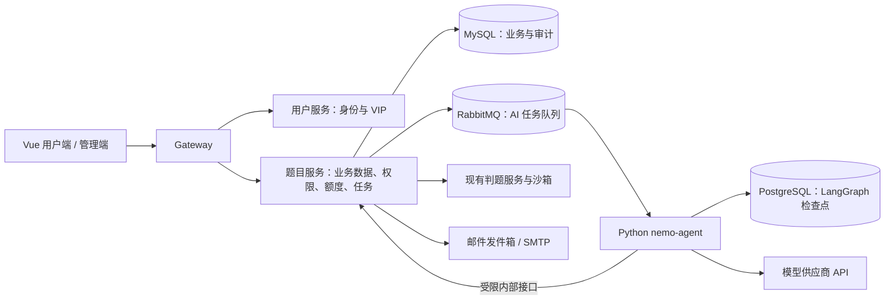

# NemoOJ AI Agent 详细实施设计与验收标准

版本：1.0　日期：2026-09-24　状态：实施中（完成项与限制见实施记录）

本文细化已确定的 AI Agent 实施方案。它是实施和验收依据，不表示功能已经上线。现有系统以 Java 微服务、MySQL、Redis、RabbitMQ、Vue 前端和隔离沙箱运行；现有用户角色为 `user/admin/ban`，公开题目的发布、版本快照和反馈处理已有独立流程。

## 一、设计决策

| 事项 | 首版规则 |
| --- | --- |
| 模型 | 调用模型供应商 API；供应商、模型、地址和密钥由部署配置提供，不在代码或前端保存密钥。尚未配置时真实调用入口关闭。 |
| 实现 | 独立 Python `nemo-agent` 服务；LangChain 负责模型与受限工具调用，LangGraph 负责四类任务编排和持久化恢复。 |
| 提交分析 | 用户在判题终态后手动触发；普通用户每天成功生成最多 5 份，VIP 无每日次数上限。 |
| VIP | 独立权益和到期时间；仅运维命令开通或撤销，不给管理员增加开通 VIP 或提权能力。 |
| 题单 | VIP 填写目标后主动生成；默认 14 天、可选 7–30 天。用户主动调整未完成任务。 |
| 私人题 | 仅本人可见；隔离于公共题库、题号和统计；经多语言、多模式验证后才允许在线判题。 |
| 打卡 | 本人对题单绑定的具体版本获得 Accepted 后自动完成；重复事件幂等。 |
| 反馈 | 有充分证据时 Agent 可自动答复；不确定或涉及故障、题目修改时转人工并通知管理员。 |
| 公共题维护 | Agent 只能提出新版本草稿及验证报告；发布、下线、重新上线由管理员操作。 |
| VIP 到期 | 保留旧报告、题单、私人题及历史记录；仍可作答和打卡，新的生成或调整停止。 |

用户代码、题面、反馈及模型回复均为不可信内容。模型不得获得数据库、操作系统、封禁用户、角色修改、VIP 开通或直接发布题目的工具。AI 故障不得影响普通提交、判题、题库查询和人工反馈处理。

## 二、服务与数据流

- 网关新增 `/api/ai/**` 和 `/api/admin/ai/**` 路由到题目服务。浏览器沿用会话 Cookie、CSRF 和既有权限校验；Python 服务不直接暴露给浏览器。
- 题目服务持有业务数据的唯一写入权。创建任务、预占额度、写入 AI 发件箱事件在同一 MySQL 事务内完成。现有判题发件箱增加按事件类型分发的 AI 交换机/路由键；AI 消费者按任务 ID 拉取所需的最小数据，不在消息中携带用户代码。
- Python 服务只持有模型凭据及访问 Java 内部接口的服务凭据。每次内部调用携带任务 ID、短时效签名和请求 ID；Java 根据任务类型、用户归属、目标资源和允许的工具操作再次授权。只读与写入工具分开，并限制返回字段。
- LangGraph 使用持久化 PostgreSQL checkpointer，`thread_id` 固定为任务 UUID。业务最终结果始终以 MySQL 为准；检查点只保存恢复流程所需状态，并制定保留期，避免长期复制用户代码。
- 模型调用统一封装超时、最多两次退避重试、结构化输出校验、token 记账及错误分类。通过配置为四类流程指定模型，首版默认同一个模型；不假定所有供应商支持同一种结构化输出方式，接入时需能力探测。
- 异步任务状态统一为 `QUEUED/RUNNING/WAITING_REVIEW/SUCCEEDED/FAILED/CANCELLED`。消费者凭租约抢占，超时回收；同一任务的重复消息不得生成第二份报告、私人题、回复或邮件。前端每 2 秒轮询运行中任务，终态停止，刷新页面后可恢复。

LangGraph 的生产检查点与人工中断依据：[持久化](https://docs.langchain.com/oss/python/langgraph/persistence)、[中断与恢复](https://docs.langchain.com/oss/python/langgraph/interrupts)；模型输出采用 [LangChain 结构化输出](https://docs.langchain.com/oss/python/langchain/structured-output) 并在业务层二次校验。

## 三、数据库设计与迁移

新增按序迁移，不修改已应用的 V1–V10。建议 V11 存会员、AI 任务与报告，V12 存计划、私人题、维护建议和通知。部署时先备份、应用迁移、运行校验，再切换服务；回滚应用不删除新增表。

| 表或改动 | 关键字段与约束 |
| --- | --- |
| `user_membership` | `userId` 唯一、`tier`、`validFrom/validUntil`、`updatedBy`、`rowVersion`；有效 VIP 为时间范围判断，`userRole` 不变。 |
| `ai_task` | UUID 主键、`type`、`ownerUserId`、`resourceId`、`idempotencyKey`、状态、尝试次数、租约、错误码、模型配置版本、创建/完成时间；`(ownerUserId,type,idempotencyKey)` 唯一。 |
| `ai_usage` | 任务 ID 唯一、用户 ID、北京时间 `usageDate`、类别、`RESERVED/COMMITTED/RELEASED`、输入/输出 token、估算费用；`(userId,usageDate,state)` 索引。 |
| `ai_analysis` | `submissionId` 唯一、`userId`、代码及题目版本哈希、判题状态、报告 JSON、模型/提示词版本、创建时间。报告字段含 `verdictEvidence`、`likelyCause`、`locations`、`suggestions`、`complexity`、`uncertainty`。 |
| `study_plan` / `study_plan_item` | 所有者、目标和约束、周期、状态、版本号；任务项记录日序、题目来源、公开题号或私人题 ID、绑定版本、推荐理由、完成提交 ID 与完成时间。每用户至多一个进行中计划。 |
| `private_problem` / `private_problem_version` | 所有者、标题、标签、难度、状态、不可变版本内容、ACM/函数规格、隐藏用例、参考解、验证报告与哈希。所有查询以所有者为条件。 |
| `ai_maintenance_proposal` | 反馈 ID 或巡检任务、自然题号、基准公开版本、建议草稿内容及哈希、差异与证据、验证报告、`WAITING_REVIEW/APPROVED/REJECTED/STALE`、审核人和审核时间。审核通过后才生成正式题目草稿。 |
| `ai_action_audit` / `ai_notification_outbox` | 记录工具、资源、操作者类型、决策、输入输出摘要及结果；邮件记录目标邮箱标识、关联资源、状态、重试、去重键。日志和审计均不存密钥或完整代码。 |

提交表增量增加 `problemSource`（`PUBLIC/PRIVATE`，历史行默认 `PUBLIC`）和可空 `privateProblemVersionId`；将 `questionId` 改为可空，并以业务校验保证两种来源恰有一个版本引用。私人提交继续使用现有提交 ID、状态、租约、发件箱、判题资源限制、幂等请求 ID 和结果展示机制。判题服务按来源读取公开 `question_version` 或私人不可变版本，转换为同一执行计划，再调用现有沙箱。**私人题缺少版本快照时直接判系统错误，不回退到当前版本。**

公开题库统计、通过率、公开提交列表及题号筛选全部显式添加 `problemSource=PUBLIC`；私人提交只进入本人私人练习记录。迁移后立即对旧提交数量、公开统计和随机历史提交做回归比对，确保默认值及可空列改动没有改变旧数据。

## 四、接口与工作流

所有外部写接口要求登录、CSRF、请求幂等键；错误响应明确区分 `NOT_FOUND`、`FORBIDDEN`、`VIP_REQUIRED`、`QUOTA_EXCEEDED`、`TASK_CONFLICT`、`MODEL_UNAVAILABLE`、`BUDGET_EXHAUSTED`。资源不存在或属于他人时返回一致的不可见结果。列表分页上限沿用现有 20 条。

### 4.1 提交分析

| 方法与路径 | 输入和行为 |
| --- | --- |
| `GET /api/ai/entitlements` | 返回当前会员级别、到期时间、当日已用/预占/剩余额度与功能开关；不暴露平台预算。 |
| `POST /api/ai/analyses` | `{submissionId, idempotencyKey}`。仅本人终态提交；已有成功报告直接返回报告 ID，不重复扣费；否则创建任务并返回任务 ID。 |
| `GET /api/ai/tasks/{id}` | 仅任务所有者或有权限的管理员可见；返回状态、阶段、可展示错误及结果 ID。 |
| `GET /api/ai/analyses/{submissionId}` | 仅本人可读报告；管理员不能仅凭角色浏览用户代码或报告。 |

图节点：`loadSubmission → classifyVerdict → gatherAllowedEvidence → analyze → validateReport → persistReport`。仅使用提交代码、用户可见诊断、资源消耗、公开题面及公开样例。隐藏用例、参考解、其他提交与个人资料不能进入提示词。Accepted 报告给出当前复杂度、优化条件和权衡；运行错误给出诊断依据和可能原因。复杂度无法可靠判断时返回“不确定”并解释所缺信息；系统错误不生成面向代码的归因报告。

额度由 MySQL `ai_usage` 原子控制：普通用户同一北京时间日 `RESERVED+COMMITTED < 5` 时预占一格；成功保存报告才转 `COMMITTED`，失败/取消转 `RELEASED`。任务创建当天决定计费日；重复投递和已有报告均不新增计数。VIP 跳过每日计数，但保留用户级并发、每分钟频率、单任务 token 上限和平台预算保护。全局预算按供应商用量累计并设置硬停开关；具体金额在部署配置中填写，缺失时真实模型调用关闭。

### 4.2 个性化题单与打卡

| 方法与路径 | 输入和行为 |
| --- | --- |
| `POST /api/ai/plans` | `{goal, level, tags, days, minutesPerDay, sourceMode, idempotencyKey}`；仅有效 VIP；`days=7..30`，默认 14，`sourceMode=CATALOG/MIXED`，默认题库。 |
| `GET /api/ai/plans`、`GET /api/ai/plans/{id}` | 仅本人，返回计划与完成度；不返回私人题隐藏用例和参考解。 |
| `POST /api/ai/plans/{id}/adjust` | `{changeRequest, expectedVersion, idempotencyKey}`；仅调整尚未完成的任务，保存旧版本供追溯。 |
| `POST /api/ai/plans/{id}/archive` | 归档当前计划后可创建新计划，不清除已完成记录。 |

图节点：`loadOwnHistory → estimateSkill → selectPublicProblems → optionallyGeneratePrivateProblems → schedule → validatePlan → persist`。选择公共题时只使用在线题；不重复推荐已完成题，除非用户目标明确要求复习。计划最多同时有一个进行中版本。默认混合计划最多生成 5 道私人题，其余用公共题补足。生成失败时保留明确状态并替换为相近的公共题，不能显示不可用私人题。调整计划需比较 `expectedVersion`，并保留已完成项和绑定的历史题目版本。

判题服务在提交写入终态后发送幂等完成事件；题目服务用 `userId + itemId + submissionId` 和版本匹配校验 Accepted，原子写入打卡。历史已 Accepted 的本人提交在加入题单时可直接记为完成；手动按钮只能触发重新核对，不能绕过判题。题目离线后已完成项保留，未完成项提示用户调整。

### 4.3 私人题生成、验证与提交

| 方法与路径 | 输入和行为 |
| --- | --- |
| `GET /api/ai/private-problems/{id}` | 所有者可读题面、样例、支持的模式及模板；隐藏用例和参考解不返回。 |
| `POST /api/ai/private-problems/{id}/submissions` | `{language, executionMode, code, problemVersion, clientRequestId}`；复用当前提交频率及未完成配额，返回统一提交 ID。 |
| `GET /api/ai/private-problems/{id}/submissions` | 仅本人分页查看该私人题提交；统一提交详情接口仍做所有者校验。 |

生成图节点：`draftSpec → draftReferenceSolutions → createCases → schemaCheck → differentialCheck → sandboxCheck → publishPrivateVersion`。仅允许现有 Harness 支持的类型与 Java 8、Python 3.12、C++17；每题至少 20 组有效用例，包括样例、边界与随机用例。用例由独立校验器核对输入/输出格式；可穷举的规模使用暴力解对拍，三语言参考实现均在真实沙箱通过 ACM 与核心代码模式。最多自动修复两轮，仍失败则标记 `REJECTED` 并替换计划项。仅 `READY` 状态的不可变版本可提交；编辑器标注“AI 生成”，不声称自动测试能证明题目绝对正确。

### 4.4 反馈、题库维护和邮件

| 方法与路径 | 输入和行为 |
| --- | --- |
| `GET /api/admin/ai/proposals`、`GET /api/admin/ai/proposals/{id}` | 展示关联反馈、基准版本、题目差异、测试报告、任务状态。 |
| `POST /api/admin/ai/inspections` | 管理员提交公开题号或批次范围，创建手动巡检任务；限制批次大小和并发。 |
| `POST /api/admin/ai/proposals/{id}/decision` | `{decision, expectedProposalVersion, expectedLifecycleVersion, note}`；仅管理员。批准后仍调用现有生命周期服务发布；下线/上线仍走现有管理员接口。 |

反馈新增 Agent 处理状态和来源标识；保留现有反馈单次回复模式。Agent 不使用伪造的管理员用户 ID，而以独立 `AI` 操作者标识写审计。反馈创建后触发 `loadFeedback → verifyEvidence → classify → replyOrEscalate`。仅当答案能由当前帮助说明或可核验业务状态支持、且不需修改题目或系统时，自动回复并解决；其他情况转人工，保留原因。管理员一旦接管，Agent 禁止继续写回；写回必须带反馈 `rowVersion`，冲突时重新读取并停止自动更新。

题目反馈或管理员巡检触发 `inspectPublicVersion → proposeDiff → validateCases → saveProposal → waitForReview`。建议草稿保存在 `ai_maintenance_proposal`，不使用管理员身份写入正式 `question` 表。若已有人工草稿，建议仍可保存，但审批时提示冲突且不得覆盖。建议绑定基准题号、公开版本、生命周期版本和内容哈希。管理员批准时重新核对这些值，在管理员身份下调用现有生命周期流程创建正式新版本草稿、保存已验证内容并发布；管理员在界面改动建议后必须重新验证再批准。任一基准变化则置为 `STALE`，要求重新验证和审核。LangGraph 的人工中断可保存等待状态，但审批成功与是否发布以 Java 的事务结果为准。邮件发件箱仅通知“无法自动解决／需要人工处理”，寄往部署指定地址，正文提供摘要及后台链接；`feedbackId + escalationType` 去重，失败重试并展示失败状态。

### 4.5 前端与运维

- 用户端提交详情与工作区增加 AI 分析入口、当日额度、报告、任务状态和错误提示；新增 `/study-plans` 与私人题工作区。私人题路径使用不包含公共自然题号的独立 ID。
- 管理端新增 `/admin/ai`，只显示巡检、反馈升级和草稿审核；保持普通用户与管理员现有导航隔离。
- `deploy/.env.example` 增加模型供应商配置、预算、AI 消费者、PostgreSQL、SMTP 和功能开关占位符；真实密钥不提交。Compose 中新增 Agent 与 PostgreSQL，仅内网访问，Agent 不接沙箱网络或 Docker socket。
- 新增运维 VIP 命令，交互或安全输入账号、起止时间和原因，执行后核验权益并留审计；账号不存在、管理员账号或已封禁账号时拒绝，不修改 `userRole`。
- 功能开关分别控制分析、学习计划、私人题生成和反馈自动处理。缺少模型配置时相应 AI 入口显示不可用，原有题库与判题保持可用。

## 五、验收标准

以下项目按阶段执行，任何阻断项未通过不得开启对应生产功能。测试先用固定响应模型和隔离数据库，再用实际模型供应商 API 小批量验收。真实调用验收需配置有效 API、预算和 SMTP 测试地址；未配置时只记录“未执行”，不得写为通过。

| 编号 | 场景与操作 | 通过标准 |
| --- | --- | --- |
| A01 | 对存量数据库执行 V11/V12 后抽查旧用户、166 道公开题、版本和提交 | 题目总数、公开题号、历史提交和原有统计不变；开启私人题前可回滚到旧应用，开启后回滚须保留具备 `problemSource` 识别能力的最低兼容版本。 |
| A02 | 普通用户同时发起 6 个不同提交的分析 | 同一天最多 5 个任务可预占；第 6 个返回额度错误；已成功报告重复请求不扣额。 |
| A03 | 让模型超时、返回无效结构或任务进程重启 | 任务最多按策略重试；失败释放额度，无空报告；恢复后不重复扣费或写报告。 |
| A04 | 对 Java/Python/C++ 的编译错误、运行错误、错误答案、超时、Accepted 生成报告 | 结果引用实际判题信息，给出可理解的原因或优化建议；无法判断时明确标记不确定；系统错误不归咎于用户代码。 |
| A05 | 用户 B 请求用户 A 的提交分析、报告、私人题和题单 | 接口均拒绝且不泄露资源存在性；管理员业务界面也不能无依据浏览私人代码。 |
| A06 | 模型提示中注入“发布题目、泄露隐藏用例”等指令 | 无越权工具调用；报告不包含隐藏用例、参考解、凭据或其他用户信息。 |
| A07 | 通过运维命令开通、到期或撤销 VIP | 生效/到期时间正确，普通用户每日额度恢复；`userRole` 不变；管理员页面不能执行 VIP 开通。 |
| A08 | VIP 生成 14 天题单并主动调整，旧计划归档 | 题单匹配目标和时间；完成项不变；并发调整仅一个成功；非 VIP 不能新建或调整。 |
| A09 | 混合题单生成私人题，查询公共列表和统计 | 私人题只对本人可见，可生成有效模板；公共题数和公共统计不变。 |
| A10 | 对私人题使用三语言、ACM 与核心代码模式提交参考解 | 每种组合在真实沙箱得到 Accepted；错误代码能返回正常判题结果；版本快照可复现。 |
| A11 | 私人题生成失败或验证不足 20 组有效用例 | 题目不得进入 `READY` 或接受提交；计划以公共题替代并展示原因。 |
| A12 | 本人获得对应版本 Accepted、重复消费完成事件、VIP 到期 | 题单项只完成一次；错题或其他用户提交不打卡；到期后旧私人题仍可提交打卡。 |
| A13 | 可核验反馈、模糊反馈、管理员接管和反馈并发修改 | 仅可核验反馈自动解决且显示 AI 来源；模糊反馈转人工；接管与冲突后 Agent 不覆盖管理员回复。 |
| A14 | Agent 发现题面错误并生成维护建议 | 仅产生草稿和验证报告；管理员批准前公开版本不变；基准版本变化后批准失败并标记过期。 |
| A15 | 人工升级邮件发送失败、重复消息投递 | 同一升级不重复发信；失败记录可见并重试；未成功时不显示“已通知”。 |
| A16 | 关闭模型 API、耗尽预算、停止 Agent 容器 | 原有登录、题库、普通提交、判题和人工反馈可正常完成；AI 入口给出明确错误。 |
| A17 | 前端类型检查、Lint、单元测试、生产构建；Java/Python 服务测试 | 全部通过；浏览器验证桌面和移动宽度下的任务恢复、导航隔离及权限错误。 |

真实联调至少使用两个普通账号、一个有效 VIP 账号和独立管理员账号；测试结束删除临时用户与 AI 任务数据，不删除原有 166 道题或用户提交。记录供应商、模型版本、响应时间、token 和估算费用；对报告质量抽取每种判题结果不少于 5 例人工复核。上线顺序为迁移和备份、服务健康检查、只开提交分析、再开题单和私人题、最后开反馈自动处理；每一阶段先在小范围账户开启，通过对应验收项后再扩大。回退时关闭 AI 功能开关并停止 Agent，保留任务与审计数据供排查。
