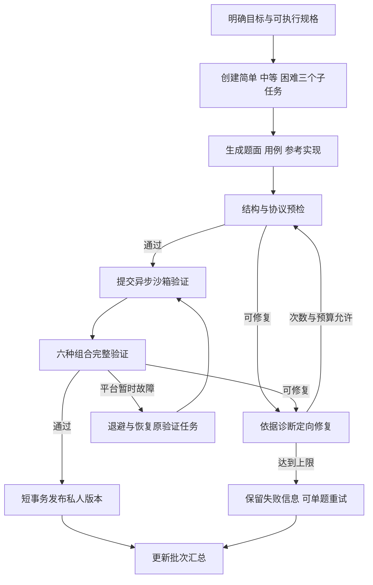

# NemoOJ AI 刷题计划与私人题生成修复建议

日期：2026-10-10　版本：1.1　状态：功能修复已部署，主要联调通过；规模样本及完整断网/容器重启场景待补测

本文根据原有代码和用户反馈制定修复范围，以下“当前实现”表描述修复前的情况。新版页面为 `TrainingPage.vue`，迁移为 V21；部署说明见 [AI_TRAINING_DEPLOY.md](../../deploy/AI_TRAINING_DEPLOY.md)，执行证据见 [实施与验收记录](../log/2026-10-10-ai-training-repair.md)。原 AI 设计见 [AIAgentImplementationDesign.md](AIAgentImplementationDesign.md)；发生冲突时，本文仅替代其中学习计划与私人题生成部分，其他业务规则沿用当前实现。

## 1. 问题与代码依据

| 问题 | 当前实现 | 影响 |
| --- | --- | --- |
| 目标与标签冲突 | 学习计划和私人题共用 `goal`、手输 `tags` 和同一表单 | 用户不知道哪个输入起决定作用，私人题需求受公共分类干扰 |
| 题单偏离目标 | 后端提供全部在线题目的题号、标题、标签，未先按标签筛选 | 模型可能用相关基础题替代用户要求的具体知识点 |
| 自动补题不保留主题约束 | 计划归一化从候选目录中选未使用题目补齐日期或替换错误题号 | 当前目录是整份题库，补题可能与主题无关 |
| 私人题入口过深 | 计划条目和私人题列表纵向堆叠 | 长计划下查看私人题需要大量滚动 |
| 一次仅生成一题 | 前端调用单题接口，并固定传入 `MEDIUM` | 不支持同一主题的难度递进训练 |
| 生成与验证较重 | 模型生成六份参考实现、ACM 与核心代码各 20 组用例，判题服务逐组合验证 | 全部验证涉及六种语言/模式组合、120 次用例执行；不能简单复制三遍后承诺提速 |
| 沙箱失败即终止 | Agent 只对不可解析的输出做有限重试；Java 验证失败后将私人题标为拒绝、任务标为失败 | 用户需要手动重新生成，已生成的数据不能用于定向修复 |
| 验证阻塞任务交付 | 沙箱验证在结果回调事务中执行，Agent 等待回调；当前 AI 消费者 `prefetch=1` | 增加事务持锁时间，并可能延迟其他 AI 任务 |

核查文件：

- [StudyPlansPage.vue](../../nemo-frontend/src/pages/StudyPlansPage.vue)：共用表单、任务和生成入口。
- [StudyPlanController.java](../../OJ-backend-microservice/OJ-backend-question-service/src/main/java/com/nemo/OJbackendquestionservice/controller/StudyPlanController.java)：计划参数、VIP 校验、任务创建。
- [PrivateProblemController.java](../../OJ-backend-microservice/OJ-backend-question-service/src/main/java/com/nemo/OJbackendquestionservice/controller/PrivateProblemController.java)：单题生成和归属校验。
- [AgentInternalController.java](../../OJ-backend-microservice/OJ-backend-question-service/src/main/java/com/nemo/OJbackendquestionservice/controller/AgentInternalController.java)：全题库候选上下文、事务内沙箱验证、失败终态。
- [analysis_graph.py](../../nemo-agent/nemo_agent/analysis_graph.py)：题单归一化、单题生成与格式重试。
- [PrivateProblemValidationService.java](../../OJ-backend-microservice/OJ-backend-judge-service/src/main/java/com/nemo/OJbackendjudgeservice/judge/PrivateProblemValidationService.java)：六种组合的顺序验证。
- [worker.py](../../nemo-agent/nemo_agent/worker.py)：任务租约、检查点恢复、结果交付与消费配置。

生成缓慢的结构性原因已通过代码确认；各阶段实际耗时和主要占比尚未测量，需要在实施时记录，不能把网络或模型耗时当作已测得的主要瓶颈。

## 2. 建议采用的业务边界

| 项目 | 刷题计划 | 私人题目 |
| --- | --- | --- |
| 输入 | 公共题库算法标签、水平、周期、每天用时 | 自由描述训练目标或题目要求 |
| 题目来源 | 当前在线公共题库 | AI 生成，独立于公共题库 |
| 用户目标文本 | 新建计划不再要求填写 | 必填，最多 1000 字 |
| 标签 | 从现有算法分类中选择 | AI 自动提取，仅作私人题展示信息 |
| 默认数量 | 按周期与每日用时排期 | 简单、中等、困难各一题 |
| 完成规则 | 对绑定版本 Accepted 后自动打卡 | 展示每题练习与首次 Accepted 状态 |
| 权益 | 新建、调整仍需有效 VIP | 新生成、重试仍需有效 VIP |

- 新建刷题计划固定使用公共题库，取消“混合题单”选项。
- 现有混合计划、私人题、提交和完成记录继续保留；已有混合计划不自动转成纯题库计划。
- VIP 到期后沿用现有规则：已有内容可查看、练习和打卡，新的生成或调整关闭。
- 普通用户每日五次代码分析的规则不在本次修复范围内。
- 私人题继续仅本人可见，不分配公共自然题号，不影响公共题库提交数和通过率。

## 3. 页面设计

保留一个导航入口，建议命名为“AI 训练”，内部提供两个标签页，而不是再增加两个侧栏入口。

### 3.1 刷题计划标签页

上方为生成表单，下方为当前计划及历史计划入口。

- 算法标签使用彩色方形标签多选框，复用题库筛选的视觉样式，取消逗号分隔输入。
- 标签数据来自全部在线题目的有效算法分类，接口返回各分类可用题数；不能只收集当前题库分页中的标签。
- 简单、中等、困难属于难度，不混入算法主题选择；难度安排依据当前水平逐步提高。
- 首版建议最多选择六个算法标签；保留水平、7–30 天、每日 10–240 分钟等现有参数范围。
- 展示候选题数量、已完成题数量和预计可覆盖周期；最终数量以后端提交时重新校验为准。
- 默认排除本人已 Accepted 的题目，可主动勾选“允许复习已完成题目”。同一份计划仍不重复题号。
- 自动生成计划名称，例如“链表与二叉树 · 14 天刷题计划”。后端可以据标签生成内部目标说明，兼容原有目标字段。
- 当前计划按天分组，默认展开当前练习日；保留整体进度、去练习、调整未完成任务、归档功能。
- 候选不足时明确提示减少每日题数、缩短周期或允许复习；不自动填入无关题目。

多标签语义：候选题至少包含一个所选算法标签，排期需要覆盖每个所选标签；不能采用“每道题必须同时包含全部标签”的规则。展示每个主题的覆盖数量，后端负责检查覆盖是否满足。

### 3.2 私人题目标签页

上方为需求输入与“生成三道训练题”按钮，下方为生成批次与私人题列表。

- 示例需求：“生成三道围绕红黑树插入、旋转和性质验证的递进练习”。
- 无须填写公共标签。模型可以生成私人知识点，例如“红黑树”“旋转”，不自动加入公共标签目录。
- 对模糊需求先返回需要明确的范围；对现有输入输出协议无法表达的要求解释原因，不能悄悄换成其他主题。
- 每批固定三张卡片，分别显示绿色简单、淡黄色中等、红色困难；卡片分别显示生成、验证、修复与可练习状态。
- 一道题通过完整验证后即可进入练习，无需等待其他题完成。
- 对最终失败题提供原因摘要和“重试这道题”；不得强制重生成已成功的题目。
- 私人题列表按批次展示，支持难度和状态筛选，以及后端分页，避免无限增长。
- 切换标签页不丢表单；URL 保存 `tab=plans` 或 `tab=private`，刷新与浏览器返回恢复当前页签。
- 计划和私人批次分别保存任务 ID，按用户隔离缓存、查询和加载状态，防止相互覆盖。

## 4. 刷题计划匹配与校验

### 4.1 创建前校验

1. 校验身份、VIP、请求限流及平台预算。
2. 校验标签确实属于当前在线题库分类，拒绝未知标签；不接受用户手输任意标签绕过候选限制。
3. 按标签筛选在线公开版本，按复习选项处理本人 Accepted 题目。
4. 验证每个所选主题均存在候选，按天数、预计每日题数检查可排期数量。
5. 无法排期时返回具体原因和可调整项，尚未开始模型调用时不预扣模型费用。
6. 将候选题号及对应版本、标签、难度保存为本次任务的候选快照，再创建任务和 Outbox。

已完成题识别同时检查 `status=2` 和判题结论 `accepted`。本项目当前 `status=2` 表示成功，失败终态为 `status=3`；双重判断避免脏数据或将来状态语义调整误触打卡。

### 4.2 模型排期与结果校验

- 只向模型提供筛选后的目录，由模型安排先后顺序、每天任务和推荐理由。
- 后端验证题号属于候选快照、版本仍在线、题号不重复、日期和每日题数合法、所选主题都有覆盖。
- 调整计划时保留已完成项目及首次完成提交，重新校验未完成项目，使用计划版本号防止并发覆盖。
- 补齐日期、替换重复题等修复只能从同一主题候选中进行；候选不足则停止排期并说明原因。
- 发布到用户页面前再次检查题目在线状态；发布后题目下线沿用现有不可用标记与处理规则。

标签不存在不等于题库没有对应知识。后续可增加标题、题面检索和知识点别名，例如“动态规划/DP”；发现分类遗漏可由管理员补标签。本次不必引入向量数据库。缺少完整主题题目时，允许用户明确选择前置练习或进入私人生成，不能把二叉搜索树练习直接宣称为红黑树训练。

## 5. 三题批量生成的数据与接口建议

所有名称为建议，实施时应沿用项目命名规范与现有序列化约定。

### 5.1 数据组织

新增私人生成批次及固定槽位关系，复用现有 `private_problem`、版本表和 `ai_task`。

| 数据 | 建议字段与约束 |
| --- | --- |
| `private_generation_batch` | ID、ownerUserId、原始目标、明确后的规格摘要、幂等键、汇总状态、rowVersion、创建/完成时间；用户与幂等键唯一 |
| `private_generation_batch_item` | 批次 ID、难度、私人题 ID、当前任务 ID、当前修订号、状态；批次与难度唯一，固定三个槽位 |
| 生成修订与验证记录 | taskId、revision、draftHash、规格与候选草稿、验证阶段、组合、结果、诊断摘要、修复次数、耗时；同一任务与修订唯一 |

批次是业务聚合记录，不额外制造一个调用模型的父任务；初次创建三个子任务，共同归属一个批次。这样避免父子任务重复扣预算和重复占用用户活跃任务上限。

批次状态建议为 `QUEUED/RUNNING/SUCCEEDED/PARTIAL_FAILED/FAILED/CANCELLED`；三个子任务继续使用现有 `ai_task.status`，通过 `stage` 描述阶段。只有三道题均可用时批次成功；至少一题成功且其他题最终失败时为部分失败。不存在“一题可用但整个批次显示全部完成”的情况。

### 5.2 公开接口

| 接口建议 | 用途 |
| --- | --- |
| `GET /ai/plans/topics` | 在线算法分类、可用数量，支持按是否允许复习计算候选 |
| `POST /ai/plans` | 新参数采用标签、水平、周期、每日用时、复习选项与幂等键 |
| `POST /ai/private-problem-batches` | 自由目标与幂等键；返回批次 ID 及三个子项 |
| `GET /ai/private-problem-batches` | 仅查询本人批次，分页且限制 pageSize |
| `GET /ai/private-problem-batches/{id}` | 批次汇总与各题进度 |
| `POST /ai/private-problem-batches/{id}/items/{difficulty}/retry` | 仅重试本人最终失败的槽位，带 expectedVersion 与幂等键 |

保留现有私人题详情、模板、提交和历史查询接口。旧单题创建接口在兼容期仍可处理旧客户端请求，但新页面只使用三题批次。新刷题计划接口要明确区分新版输入，不能让旧自由目标请求在字段变更后被悄悄忽略。

## 6. 生成、验证、自动修复工作流

### 6.1 难度与主题约束

- 三题共享用户目标，每题有独立规格，不只是相同题面换一个难度标记。
- 简单题针对核心性质或单项操作；中等题组合相关操作；困难题增加数据规模、操作类型或复杂度约束。
- 若目标天然较复杂，应先明确训练层次，显示基础练习与目标的关系，不强行声称所有简单题都直接实现完整复杂结构。
- 发布前检查题面和实现是否符合规格；沙箱通过表示参考实现与用例一致，不等于已经证明题意正确或难度准确。

### 6.2 预检与分阶段验证

1. 校验结构、参数类型、样例、资源范围、用例数量、模式与函数签名一致性。
2. 检查 ACM 与函数输入是否表达同一批逻辑用例，减少两套独立生成导致的不一致。
3. 优先运行小规模基准实现和关键边界用例，尽早暴露错误；预检通过并不允许用户提交。
4. 执行 Java、Python、C++ 的 ACM/核心代码完整用例验证，保留现有多语言、多模式门槛。
5. 全部通过后保存不可变版本、公开样例和模板，标记私人题可练习。

建议用一份规范用例数据生成两种输入表达，并逐步用平台模板生成入口、标准导入和协议适配代码，减少模型需要重复输出的内容。涉及复杂数据结构时必须验证转换规则，不能假定所有函数题都能自动转换成任意 ACM 输入格式。

### 6.3 修复策略

| 失败类型 | 建议处理 |
| --- | --- |
| JSON/字段/输入协议错误 | 返回精确字段诊断，修复当前候选，不丢弃整个目标 |
| 某语言编译错误 | 修复该语言实现或确定性模板错误，保留无关部分 |
| 运行异常、超时、输出不一致 | 结合具体失败组合、用例和诊断核对规格、实现及预期结果 |
| 网络、沙箱不可用、租约变化 | 与题目错误区分，退避恢复；不通过修改题面应对平台故障 |
| 无法表达的规格或范围不清 | 明确说明限制或请求补充需求，不强行发布 |

- 每题默认允许两轮业务修复，即初次生成后最多再修复两次；模型 HTTP 调用另受现有调用账本和上限约束，预算或调用数耗尽时可以提前结束。
- 子任务从实际开始处理起默认最多运行 15 分钟，排队时间单独统计；长阶段需定期续租，期限用持久化开始时间计算，进程重启不能重置。到期停止新增模型调用，安全收束正在运行的验证并转为明确终态。
- 格式重试、网络重试与业务修复合并计算实际模型调用数，避免多层重试相乘。首版每题模型调用总上限建议保持四次，每批最多十二次；最终由部署预算配置确定。
- 定向修复返回新的 revision；验证结果绑定 draftHash，旧版本迟到结果不能发布新候选。
- 仅在相关实现、用例、规格、比较器、模板及运行时镜像版本都未改变时，复用已通过的验证结果；不得沿用不适用的旧证据。
- 预期输出不能仅因参考实现失败就被改成程序实际输出。可用小规模穷举、独立基准解或性质检查辅助核对；无法建立足够证据时结束并给出原因。
- 保留结构化失败证据供 Agent 修复。用户仅看到简洁诊断，隐藏用例、参考实现和容器目录不通过公开接口泄露。

LangGraph 采用条件分支组织验证与修复，检查点保存当前修订、已完成步骤和验证任务 ID。外部写入与验证调用必须幂等；进程重启后先查询业务记录再决定是否恢复，不能只依赖内存计数。参考：[工作流模式](https://docs.langchain.com/oss/python/langgraph/workflows-agents)、[持久化与恢复](https://docs.langchain.com/oss/python/langgraph/persistence)。

## 7. 速度、资源与可靠性

### 7.1 异步验证与短事务

当前结果回调需要拆为“保存候选与创建验证任务”“后台执行验证”“短事务处理验证结果”三步。

- 沙箱执行不持有题目、任务或预算数据库行锁。
- 内部创建验证接口返回验证任务 ID；验证结果接口返回状态及结构化证据，均保留签名、任务归属与租约校验。
- 对重复请求，按 taskId、revision、draftHash 返回同一验证任务；终态回调重复执行不生成第二份版本。
- 候选、验证中间结果及修复记录为内部数据，不提前暴露成可提交题目。
- 超时、重启和跨云短暂断线可恢复原任务；已经 READY 的私人版本不因其他子题失败而被删除。

### 7.2 队列与并发默认值

- 代码分析、计划排期和私人题生成采用分开的路由/队列及消费预算，代码分析优先；低优先级任务仍需有公平调度，避免永久饥饿。
- 分队列同时分配独立消费槽位，单纯增加队列名称不能解决一个消费者被长任务占住的问题。
- 阿里云模型调用全局并发建议从 2 开始，遵守供应商请求限制；模型通过远程 API 调用，不在服务器本地运行。
- 腾讯云私人题完整验证全局并发先设为 1；三个难度任务允许模型阶段有限并行，验证阶段排队。
- 复用现有沙箱并发槽位和资源约束，不为了三题批次直接启动十八份参考实现并行验证。
- 明确普通用户判题的优先权与保留资源；空闲时运行后台验证，不能仅把两个工作队列都设为最高优先级。

实施复测补充：核心服务器实际只有两个沙箱槽位，仅在请求入场时排序会让已开始的 20 用例验证长期占满槽位。已增加用例容器边界的合作让位，后台任务归还槽位后保留工作目录继续执行；不抢占运行中的进程、不共享容器。原始竞争样本和修复后对照均写入实施记录，不能忽略初次 P95 不达标的结果。

### 7.3 额度与费用

- 初次创建批次时原子检查三个子任务所需的用户任务容量、请求限流与平台预算，全部获准才创建；不足时不产生残缺批次。
- 平台预算按子任务预占、按模型调用结算；汇总批次不重复记账。
- 自动修复沿用子任务和剩余预算；用户主动重试失败槽位创建新的任务并记录关系，旧费用和失败历史保留。
- 幂等重复请求复用批次，不产生新的题目、模型调用或费用记录。
- 延续有效 VIP 无每日分析次数上限的规则；批量生成仍受平台预算、活跃任务数和速率约束。

### 7.4 进度与监控

子任务 stage 建议包括 `SPECIFICATION/GENERATING/PRECHECK/VALIDATION_QUEUED/VALIDATING/REPAIRING/PUBLISHING`。页面显示真实阶段、已验证组合数量和修复轮数，不使用与实际过程无关的假百分比。关闭页面不取消后台任务。

记录：排队、需求明确、模型生成、预检、各语言模式验证、修复、落库、首题可用和整批完成耗时；统计首轮通过率、最终通过率、每批费用及人工重试率。监控标签只用有限任务类型、语言、模式、阶段和结果；目标、用户 ID、批次 ID 与任务 ID 不作为指标标签。

## 8. 实施顺序与发布安排

| 阶段 | 工作 | 完成条件 |
| --- | --- | --- |
| P0 | 增加阶段耗时与失败分类，采集现有单题基线 | 能区分排队、模型、校验时间；保存不含敏感数据的汇总 |
| P1 | 标签页拆分、标签选取、纯题库计划候选约束 | 不生成无关题单，私人列表不再藏在长计划下 |
| P2 | 异步验证、结构化诊断、有限修复与恢复 | 可修复样本无需用户重新生成，验证不持有长事务 |
| P3 | 三难度批次、独立交付、失败槽位重试和分页 | 三题互不影响，部分失败可恢复 |
| P4 | 有限并行、模板复用、队列隔离与性能复测 | 提速证据完整，正常判题性能无明显下降 |

迁移采用下一个未占用的版本号，实施前核对本地与两台服务器的迁移记录；不能根据本文日期直接假定版本号。先增加表与兼容字段，再部署后端与 Agent，最后发布新页面。

通过配置开关分别控制新版计划、批量生成与自动修复。先在隔离环境验证，再小范围启用。需要关闭新入口时，已有题目、任务与记录仍能读取；运行中的修复任务应由兼容消费者处理完或安全转终态，不能直接停止所有消费者造成租约堆积。

只做向前兼容迁移，不删除旧业务数据。不安排额外备份任务，沿用用户“暂时不备份”的当前要求；发布回退依靠保留原镜像、兼容读取和功能开关，不依赖回滚删除新表。

## 9. 验收标准

| 编号 | 场景 | 通过标准 |
| --- | --- | --- |
| A01 | 标签页拆分 | 计划与私人题独立展示；切换、刷新、返回后页签与所属用户任务恢复正常 |
| A02 | 计划输入 | 新计划无需目标文本；标签必须选自有效算法分类；公共难度标签不充当主题 |
| A03 | 主题匹配 | 单选、多选的所有公共题来自候选快照；每个选定主题均有覆盖，补题不越界 |
| A04 | 无题和题数不足 | 明确提示缺失主题/数量；未调用模型时无模型费用；不生成无关填充题 |
| A05 | 复习与调整 | 默认排除已 Accepted 题；主动允许复习后可纳入；调整保留已完成项目和首次完成提交 |
| A06 | 三难度生成 | 幂等创建一个批次、三个固定难度槽位；题目围绕同一目标且训练要求递进 |
| A07 | 私人题主题 | 自由目标不被公共标签限制；无法表达或范围不清时说明原因，不静默换主题 |
| A08 | 独立交付 | 第一道题 READY 即可练习；另外两道失败或处理中不会撤销已成功题 |
| A09 | 自动修复 | 覆盖字段错误、编译错误、运行错误和输出不一致；有可修复诊断时自动重试，受次数、费用和期限限制 |
| A10 | 验证质量 | READY 前三语言两模式完整验证均通过；两种输入协议一致；不盲目改预期输出迁就错误程序 |
| A11 | 部分失败重试 | 仅重试所选失败槽位；成功题 ID、版本和提交记录不变；旧失败证据与费用保留 |
| A12 | 幂等与迟到结果 | 重复创建、回调、验证消息不增加题目或费用；旧 revision 和失去租约的结果不能发布 |
| A13 | 故障恢复 | Agent 重启、验证进程重启、跨云断连后可恢复；平台故障与内容错误明确区分 |
| A14 | 权限与信息隔离 | 普通用户不能新生成；用户不能读、重试或提交他人私人题；隐藏用例和参考实现不从公开接口返回 |
| A15 | 兼容旧数据 | 已有混合计划、私人题、完成记录和提交仍可用；VIP 到期后的已有内容规则不变 |
| A16 | 预算与任务容量 | 三子任务原子创建；并发请求不超预算；自动修复、网络重试和格式重试都进入调用账本 |
| A17 | 页面与响应性 | 桌面、390px 手机宽度无溢出；任务加载动画与进度准确；私人题分页正常；长计划不妨碍查看私人题 |
| A18 | 事务与资源 | 沙箱执行期间不持有业务长事务；后台验证并发上限有效，结束后无测试容器残留 |

自动化检查：前端 TypeScript、ESLint、Vitest 和生产构建；Java 相关模块测试与构建；Python Agent 单测。新增测试重点是主题约束、批次状态、重试上限、幂等恢复、预算并发和权限，不只验证页面是否包含某段文字。

真实性能验收采用相同模型、题目目标、运行时、用例门槛和机器配置，记录供应商响应波动。基线与新流程分别至少测试十个单题样本，新流程另测试十个三题批次，覆盖基础、中等与复杂目标。记录 P50/P95、最终成功率、首题可用时间、整批完成时间和每批费用；单独汇总发生修复的样本，不能剔除失败任务后声称性能通过。

初步性能目标：同口径单题验证耗时 P50 相对基线降低至少 20%；在固定正常提交负载下，开启私人题验证后的普通判题 P95 增幅不超过 10%，系统错误率保持 0。三题批次以首题可用与整体交付分别衡量，不要求三题完整验证与旧单题同样快。若供应商波动导致无法判断，增加样本后再决定是否达标；优化不能以减少六种组合验证或公开不完整题目换取速度。

## 10. 本次明确不纳入

- 不改普通代码分析每日额度、登录/提交限流、用户角色和管理员权限。
- 不把私人题加入公共题库，不自动上线、修改或下线公共题目。
- 不接入本地大模型、不新增向量数据库，不承诺任意主题均能生成可判题内容。
- 不删除旧计划、不清空私人题或历史提交。

上述首版默认值用于形成可执行方案；实施期间如测量证明并发、调用上限或验收阈值不合适，应记录证据并更新本文，不能仅为使测试通过而放宽校验或隐藏失败。
