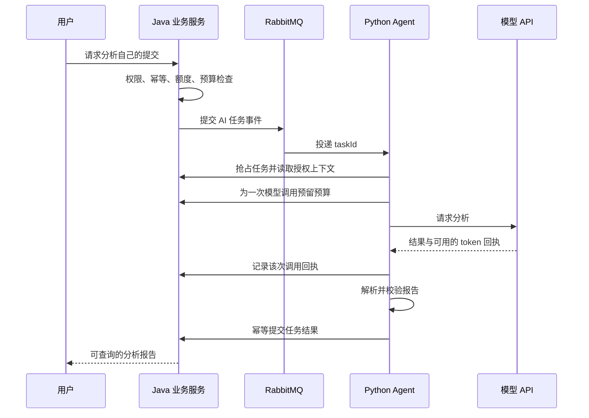

<a id="foundations"></a>

## 第一章：先理解模型、Agent 和 Workflow

### 1.1 从一个你熟悉的业务出发

在 NemoOJ 中，用户提交代码后，判题器产生 AC、CE、RE、TLE 等结果。用户还希望知道“为什么失败”或者“哪里可以优化”。

最简单的做法是把源码和公开诊断交给模型，取得一段文字。这是一次模型调用。如果程序固定执行“检查身份 → 读取提交 → 调用模型 → 校验报告 → 保存报告”，就是使用模型的工作流。如果模型可以自己决定先读题面、再查询某个工具、根据工具结果继续行动，则具有更明确的 Agent 行为。

这三个层次解决的问题不同：

| 层次 | 谁决定下一步 | 示例 |
| --- | --- | --- |
| 模型调用 | 调用它的程序 | 输入错误信息，得到说明 |
| Workflow | 预先写好的图与分支规则 | CE 走诊断分析，AC 走复杂度分析 |
| Agent | 模型在程序允许的范围内选择行动 | 模型选择查询题目工具，得到结果后再推荐 |

工作流允许分支、循环和模型节点，未必是一条直线。模型生成结果可能有随机性，所以“固定的流程结构”也不等于“所有结果都确定”。Agent 也需要外部规则，例如工具范围、循环次数、预算和结果校验。

官方对预定路径与模型动态选择路径的区分见 [Workflows and agents](https://docs.langchain.com/oss/python/langgraph/workflows-agents)。本教程把这一区分落实到后面的本地题目助手与判题分析练习。

### 1.2 大模型实际在做什么

语言模型接收上下文并生成后续 token。上下文可能包含系统要求、用户问题、之前的对话、工具结果和检索到的文本。训练产生的参数决定模型怎样根据上下文计算输出概率。

模型通常不会因为你在聊天里纠正一次就永久修改参数。下一轮看见先前对话，属于上下文内使用信息；把偏好保存到数据库再读回来，属于应用记忆；通过训练更新参数，才是训练意义上的学习。

NemoOJ 的诊断应该由判题系统提供，而不是让模型凭空猜测。给模型“提交 RE”，只能说明发生运行错误；给出“第8行数组越界”的公开诊断，才提供了进一步定位的证据。报告仍可能判断错误，需要表达不确定性。

### 1.3 LangChain 和 LangGraph 分别负责什么

LangChain 提供模型、消息、提示词、工具和 `create_agent` 等应用组件。LangGraph 提供共享状态、节点、边、循环、检查点与中断恢复等编排能力。LangChain 的现代 Agent 实现本身也使用 LangGraph。

可以把二者映射到你熟悉的后端概念：

| AI 开发概念 | 接近的后端概念 | 在教程中做什么 |
| --- | --- | --- |
| ChatModel | 外部服务客户端 | 请求供应商模型 |
| Prompt | 带约束的请求模板 | 组织任务、数据和输出要求 |
| Tool | 一个受限业务函数 | 查教学题库元数据 |
| State | 执行上下文 | 保存判题结果、尝试次数与报告 |
| Node | 一步业务函数 | 解析、检索、分析或校验 |
| Edge | 流程转移 | 指定下一步或分支 |
| Checkpoint | 执行状态快照 | 暂停后找到先前进度 |
| 业务数据库 | 最终业务事实 | 保存任务、权限、额度和结果 |

框架快照与业务数据库不应相互冒充：一个图执行完，不代表报告已经成功写入 Java 服务；一个模型返回回复，不代表用户反馈已经被事务性解决。

接口入口和两框架关系参见 [LangChain overview](https://docs.langchain.com/oss/python/langchain/overview)。下面代码和 NemoOJ 的映射为本项目的教学示例。

### 1.4 为什么不把所有事情都放进 Prompt

假设 Prompt 写着“用户只能看自己的提交”。如果模型工具拥有任意读取数据库的能力，只有这句话并不能建立权限隔离。正确做法是在调用工具前，由业务服务检查登录身份与记录归属，工具只能返回授权范围内的内容。

同理，“不要重复扣费”不能代替数据库幂等约束；“不要无限重试”不能代替尝试次数上限；“输出一定正确”不能代替测试。Prompt 负责行为要求，程序负责能机械验证的约束。

在本地练习 05 中，工具只有读取合成题库的能力。在生产 NemoOJ 中，Python Agent 通过签名内部接口取得被裁剪的上下文，Java 服务掌握业务写入权。你后面会在源码中看到这条边界。

### 1.5 一张完整请求图



这是依据当前源码整理的业务解释图。执行细节还有失败重投、租约以及检查点，放到第六章说明。

### 1.6 够用的 Python 入门

本教程只要求先掌握几个概念：

- 字典 `{"verdict": "CE"}` 存键值数据，访问方式为 `data["verdict"]`。
- 列表 `[1, 3, 13]` 存多个元素，`for item in items` 遍历。
- 函数 `def prepare(state): ...` 接收参数并通过 `return` 返回值。
- 类用于描述结构或对象行为；`BaseModel` 的子类可以验证数据。
- `TypedDict` 描述字典形状，主要给类型工具看；它本身不会像 Pydantic 那样自动做运行时校验。
- `async def` 定义异步函数，调用得到协程，必须用 `await` 或 `asyncio.run()` 驱动。
- `await` 允许等待 I/O 时让出执行机会；不意味着自动增加服务器核心数，也不意味着 CPU 密集计算会自动加速。

#### 练习 00：读取一份模拟提交

```text
labpy lab00_python.py
```

完整代码：

{{CODE:labs/lab00_python.py}}

预期输出包含：

```json
{"summary":"先阅读编译器诊断，再检查对应源码行。"}
```

动手修改：把 `read_fixture()` 中的 `CE` 改成 `AC`，观察另一条分支。然后在 `explain()` 中增加 `RE` 分支，并给出“先查看公开运行诊断”的提示。

自测：为什么这里没有访问真实模型？为什么 `read_fixture()` 前面需要 `await`？如果把它改成普通函数，还需不需要 `await`？
