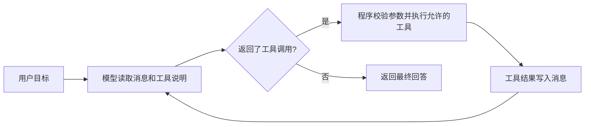

<a id="agent"></a>

## 第三章：亲手搭建一个会使用工具的 Agent

### 3.1 从“一次问答”到“行动循环”

普通聊天是：发送问题，接收回答。带工具的 Agent 还可以请求程序执行一个函数，得到结果后继续决定下一步。

假设用户说：“找一道二分查找题，告诉我它的题号。”模型自身不知道你数据库今天有哪些题目。你给它一个查询工具，它先请求 `find_problems(tag="二分查找")`；程序读取题库并返回第 3 题；模型随后组织推荐理由。工具结果进入上下文，因此回答有了业务依据。



循环里的模型决定“要调用什么”，应用负责“是否允许执行，以及怎样执行”。模型输出一段 `tool_calls` JSON 不会自动打开数据库；只有应用接到请求并调用函数，行动才发生。LangChain 的 `create_agent` 帮你组织这个循环。参考 [Agents](https://docs.langchain.com/oss/python/langchain/agents)。

### 3.2 实战 05：本地题库推荐 Agent

运行：

```text
labpy lab05_agent.py
```

完整代码如下。这里只读取合成题库的公开元数据，没有真实用户数据。

{{CODE:labs/lab05_agent.py}}

按顺序拆开理解：

1. `@tool` 把普通 Python 函数包装成工具。类型注解帮助生成参数 Schema；函数的 docstring 是模型理解用途的说明。
2. `CATALOG` 来自本地 JSON。模型不能选择任意路径，也没有得到数据库连接。
3. `find_problems` 将返回数量限制在 1–5；`get_problem` 对不存在的题号返回 `NOT_FOUND`。这些规则由 Python 强制执行。
4. 离线模型返回固定的两次工具请求；`create_agent` 实际执行这两个函数，再把结果加入消息。
5. 最后一条 `AIMessage` 没有工具请求，循环结束。

预期消息类型顺序是：

```text
human → ai(tool_calls) → tool → ai(tool_calls) → tool → ai(final answer)
```

重点看两个 `type: "tool"` 的消息。它们包含函数真正查出的数据；如果只有最终推荐文字，却没有工具执行结果，你还没有证明工具循环跑通。

工具调用一般包含：

```json
{
  "name": "get_problem",
  "args": {"problem_no": 3},
  "id": "call-detail",
  "type": "tool_call"
}
```

`name` 决定调用哪个已注册函数；`args` 是函数参数；`id` 用于关联这一次请求与对应的工具回复。同一个函数可被调用多次，所以仅有函数名不足以关联结果。工具说明与消息类型见 [Tools](https://docs.langchain.com/oss/python/langchain/tools) 和 [Messages](https://docs.langchain.com/oss/python/langchain/messages)。

### 3.3 换成真实模型

完成 0.6 的配置后执行：

```text
labpy lab05_agent.py --online
```

工具函数、题库和提示词都没有变，只替换了模型对象。此时模型可能一次发出多个工具请求，也可能采取不同顺序；判断成功的标准是查询了正确的公开数据并给出相符答案，不能硬性要求消息条数与离线脚本完全一致。

`recursion_limit=12` 限制图运行步数，不等于恰好 12 次模型调用，也不等于完整的费用控制。生产环境还要记录每次模型请求、输入输出 token、超时、任务总预算与工具次数。NemoOJ 的模型账本会在第六章解释。

离线模型的 `bind_tools` 是教学桩，不会训练它理解工具。把用户问题改成“链表题”后，固定响应仍可能查询二分查找。这正好说明：框架执行能力可以离线验证，模型的选择能力必须另行评测。

### 3.4 Agent 的最小设计清单

| 项目 | 本练习 | 放入 NemoOJ 时的设计 |
| --- | --- | --- |
| 目标 | 推荐一道公开题 | 根据用户目标、已完成记录和等级推荐 |
| 输入上下文 | 一条用户消息 | 服务端加载当前用户可访问的数据 |
| 模型 | 模拟或 API 模型 | 可配置模型与调用超时 |
| 工具 | 查询标签、读取题目 | 只暴露经过权限校验的业务能力 |
| 状态 | 消息列表 | 任务状态、结果、调用记录与检查点 |
| 停止条件 | 最终回答、步数限制 | 成功、失败、取消、超时、预算不足 |
| 验证 | 查看工具消息 | 检查题号存在、上线状态、用户归属和重复项 |

设计工具时，先考虑“能不能用一个窄函数解决”，再考虑通用执行器。例如 `get_my_submission(submission_id)` 由后端校验提交归属，比让模型任意拼 SQL 更容易验证。身份应来自已认证的服务端上下文，不能相信模型传来的 `user_id`。

### 3.5 ReAct、计划与多 Agent

ReAct 把围绕任务的推理与行动交替组织起来。教学上可以观察“选择查询工具→得到数据→继续选择→回答”的行为。调试时记录所选工具、参数、结果摘要与公开解释即可，不需要把模型内部隐藏思维链当作可审计事实。原始研究见 [ReAct 论文](https://arxiv.org/abs/2210.03629)。

“计划型 Agent”先把目标拆成步骤，再执行、校验和调整。例如学习助手先识别薄弱标签，再查询候选题，再排每日任务。计划本身也可能错误；应该检查所有题号、任务数量和完成状态。

多 Agent 是让不同职责的模型/流程协作，例如检索、生成、审核。但多个角色并不会自动提高准确率，也会增加调用次数和协调成本。先用一个图的不同节点拆分职责，通常更容易理解和测试。本教程的并行练习是两个节点，未建立多个独立的智能体。

### 3.6 记忆到底存在哪里

短期记忆通常是当前线程的对话与状态；长期记忆是跨任务保存的偏好、学习记录等。模型 API 的一次请求并不会自动记住上次聊天。应用必须读取数据，再把适当部分放入这次上下文。

NemoOJ 的“已完成题目、VIP 到期时间、每日余额”适合存在业务数据库。它们有明确的事实来源，不应让模型自由改写。用户说“我擅长链表”可以作为待确认偏好；服务端的 AC 记录可以作为已验证事实。两者要区分。

LangChain 提供相应的状态与存储使用方式，但归属校验仍由应用完成。参考 [Short-term memory](https://docs.langchain.com/oss/python/langchain/short-term-memory) 和 [Long-term memory](https://docs.langchain.com/oss/python/langchain/long-term-memory)。

### 3.7 动手修改与验收

先把 `data/catalog.json` 的第 3 题标题改成“二分查找练习 A”，运行一次，检查工具消息里的标题是否变化，再恢复文件。这验证了工具读取的数据是真实的本地文件。

第二个练习：在脚本的 `get_problem` 离线请求中把题号改为 999。你会看到 `NOT_FOUND`，但固定的最终回答仍可能推荐第 3 题。不要把它解释成框架错误：固定模拟模型不会据观察自行修正。真实模型评测需要检查它是否承认题目不存在。

本章验收标准：能解释六条消息的来源；能区分模型请求和工具执行；能说明权限为什么必须放在工具或后端；能指出离线脚本证明了什么、没有证明什么。
