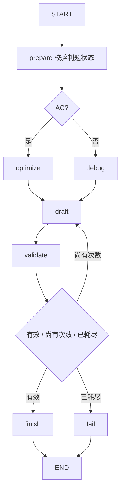
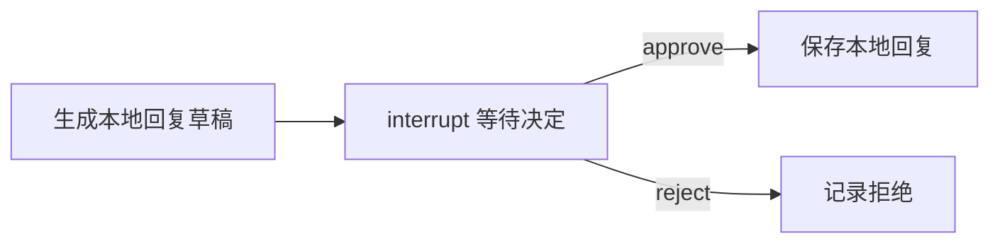

<a id="langgraph"></a>

## 第四章：用 LangGraph 搭建可控工作流

### 4.1 先画流程，再写节点

你的代码分析需求可以画成：已通过的代码走复杂度优化；编译/运行失败的代码走诊断；生成建议后验证格式；失败时最多修正一次；最后返回结果或失败状态。



这里的执行顺序由代码定义。即使 `draft` 改成真实模型，路由、重试上限和终态仍可以由程序控制。这就是工作流包含模型节点的形式。Agent 则可以在允许范围内自行选工具和下一步；两者可以嵌套。参考 [Workflows and agents](https://docs.langchain.com/oss/python/langgraph/workflows-agents)。

### 4.2 五个核心对象

| 对象 | 通俗解释 | 代码例子 |
| --- | --- | --- |
| State | 这次流程共用的资料袋 | `verdict`、`attempt`、`candidate` |
| Node | 做一件事的函数 | 生成草稿、校验输出 |
| Edge | 下一步固定去哪里 | `draft → validate` |
| Conditional edge | 根据状态选路线 | AC 走优化，CE 走诊断 |
| Reducer | 同一个状态字段怎样合并更新 | 多个节点的观察追加到列表 |

节点通常接收当前状态，返回**部分字段更新**。`return {"valid": True}` 不会清空其他字段。未配置 reducer 的字段通常按当前更新替换；需要追加的列表要定义合并规则。`TypedDict` 主要描述类型给编辑器和框架，业务输入与输出仍要显式校验。参考 [Graph API](https://docs.langchain.com/oss/python/langgraph/graph-api)。

### 4.3 实战 04：分支、有限循环和节点更新

```text
labpy lab04_workflow.py --verdict CE
labpy lab04_workflow.py --verdict AC
labpy lab04_workflow.py --verdict RE --stream
```

{{CODE:labs/lab04_workflow.py}}

阅读顺序：先 `State`，再 `Report`，再每个节点，最后看 `add_edge` 和 `add_conditional_edges`。把图连起来之前，每个节点只是普通函数。

第一次 `draft` 故意产生一个太短的建议，Pydantic 拒绝；第二次产生合格文本。CE 的关键输出应是：

```json
{
  "direction": "debug",
  "attempt": 2,
  "valid": true,
  "status": "SUCCEEDED",
  "trace": ["prepare", "debug", "draft:1", "validate:fail", "draft:2", "validate:pass", "finish"]
}
```

AC 的 `direction` 应变成 `optimize`。`--stream` 每完成一个节点就打印更新；这是**图进度流**，不是模型逐 token 输出。前端“准备中、分析中、校验中”的提示可以利用节点进度，但生产服务还要实现相应事件接口；本教程没有新增 HTTP 接口。

注意 `trace` 的节点返回值只有本节点新增的项。若返回整个历史列表，同时 reducer 仍使用 `operator.add`，旧记录会再次追加，产生重复。思考一下：无 reducer 时每次 `['draft:1']` 会覆盖历史；有 reducer 时追加，才能留下执行路径。

### 4.4 工作流失败不只有一种

把“模型回答不符合 Schema”和“网络请求超时”分开处理。前者可以提供格式反馈后有限修正；后者可能已经消耗模型费用，不能把它当成完全没发生过。

样例只有格式重试；没有假装实现完整生产重试。扩展时至少记录 `attempt`、错误类别、总时限、是否已经产生外部效果。图的 `recursion_limit` 是兜底，业务次数限制才表达你的产品规则。

动手练习：将 `draft` 的第二次文本也改为“短”，重新运行，结果应为 `FAILED` 且 `attempt` 为 2，而不是无限循环。完成后恢复原文件，以便整套测试保持通过。

### 4.5 实战 07：并行分支与汇合

```text
labpy lab07_parallel.py
```

{{CODE:labs/lab07_parallel.py}}

两个分支都写 `observations`，所以该字段定义为 `Annotated[list[str], operator.add]`。`add_edge(['classify', 'check_evidence'], 'merge')` 表示两者都完成后再汇合。不要把多个普通入边的直觉代替显式的等待条件。

最后 `summary` 应同时包含“分类”和“证据”。`sorted` 让展示顺序稳定，但它不是并行完成顺序的保证，也不是同步机制。参考 [Use the graph API](https://docs.langchain.com/oss/python/langgraph/use-graph-api)。

适合并行的是互不依赖的工作，例如获取公开题目与获取当前用户历史。后一步依赖前一步生成的题号时，就应串行。并行不一定更快：外部限流、CPU、数据库连接和共享状态都可能限制收益。

### 4.6 实战 06：把反馈回复停下来，人工批准后恢复

业务需求：AI 写好回复，但回复发送前需要管理员检查。不能只打印“等待批准”后就让 Python 进程一直睡眠。应保存状态，退出进程；管理员批准时从持久化状态继续。



{{CODE:labs/lab06_review.py}}

分三次执行，每次都是新的 Python 进程：

```text
labpy lab06_review.py start --task feedback-learning-01
labpy lab06_review.py status --task feedback-learning-01
labpy lab06_review.py resume --task feedback-learning-01 --decision approve
labpy lab06_review.py status --task feedback-learning-01
```

第一次输出包含 `__interrupt__`，内容有待批准的草稿。第二次应看到 `next` 包含 `review`。第三次变成 `SAVED_LOCALLY`，输出 `saved` 文件路径。第四次的 `next` 应为空，说明图已结束。

再用**新任务编号**检查拒绝分支：

```text
labpy lab06_review.py start --task feedback-learning-02
labpy lab06_review.py resume --task feedback-learning-02 --decision reject
```

此时状态为 `REJECTED`，不会执行保存回复的节点。文件仅落在 `labs/outputs`，不会给用户发反馈消息，也不会发邮件。

`thread_id` 是检查点的会话标识，同一个编号关联同一份状态；它不是用户认证。生产环境应将业务任务编号与拥有者绑定，避免不同用户共享一个 thread。`SqliteSaver` 让示例跨进程恢复；NemoOJ 使用的是 PostgreSQL 检查点方案。参考 [Persistence](https://docs.langchain.com/oss/python/langgraph/persistence)。

### 4.7 中断恢复时最容易踩的坑

LangGraph 在恢复时会重新进入发生中断的节点，`interrupt` 之前的代码可能再次执行。因此本例把保存回复放在后续 `save` 节点，而不是放在 `review` 的 `interrupt` 之前。参考 [Interrupts](https://docs.langchain.com/oss/python/langgraph/interrupts)。

即使副作用移到后续节点，检查点与外部系统之间也可能存在故障窗口：外部发送成功，保存检查点前进程崩溃，重放可能再次发送。生产消息/数据库写入仍要使用业务幂等键，例如 `(task_id, action_type)` 唯一约束，而不能仅靠“用了检查点”保证恰好一次。

本例按任务哈希覆盖一个本地文件，演示避免追加重复内容；它不等价于邮件系统事务。SQLite 保留状态后，重复 `start` 会报错；已结束任务再次 `resume` 也会报错。学习时换一个任务编号即可，无需删除整个输出目录。

### 4.8 同步、异步与持久化的关系

`invoke` 是同步执行；`ainvoke` 需要 `await`；`stream`/`astream` 逐步给出事件。是否持久化取决于 compile 时提供的 checkpointer，并不取决于你选同步还是异步。

```python
import asyncio

async def demo():
    graph = build_graph()
    result = await graph.ainvoke({"verdict": "CE", "trace": []})
    return result

# 普通脚本可以 asyncio.run(demo())。
# 在已经有事件循环的 Notebook/ASGI 应用里应直接 await demo()。
```

上段依赖实战 04 的 `build_graph`，用于展示调用差别。实战 11 则完整演示 `asyncio.run` 与项目异步节点。不要将一个 coroutine 对象当成已经得到的结果。

本章验收：能画出图；能说明每个状态字段的更新方式；验证失败能进入有限重试；并行两项都进入汇总；关闭进程后仍能批准或拒绝；能够解释检查点为什么不替代业务幂等。
