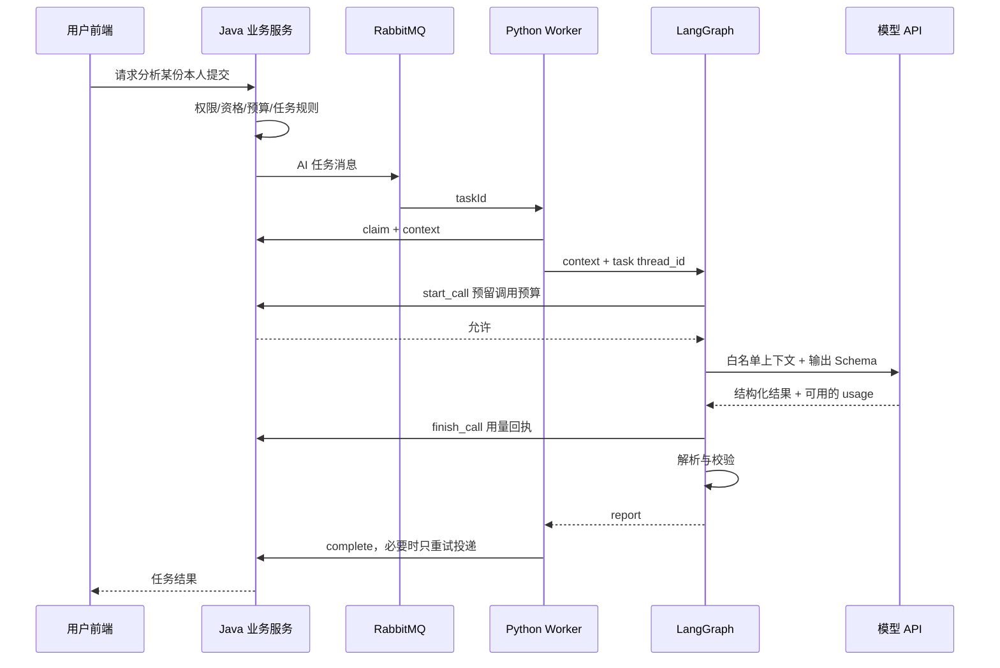

<a id="nemooj"></a>

## 第六章：把教程和 NemoOJ 的真实 Agent 对上

本章依据 2026-10-06 工作区源码。它解释当前实现，不宣称云端配置、模型价格或运行状态已经再次验收。运行教学样例不需要启动腾讯云、阿里云或虚拟机。

### 6.1 先看目录，而不是一次读完所有代码

推荐按下面顺序阅读：

| 顺序 | 当前文件 | 要回答的问题 |
| --- | --- | --- |
| 1 | [config.py](/C:/Users/nemo/Desktop/NemoOJ/nemo-agent/nemo_agent/config.py) | 模型、超时、内部服务与检查点配置从哪里来？ |
| 2 | [schemas.py](/C:/Users/nemo/Desktop/NemoOJ/nemo-agent/nemo_agent/schemas.py) | 输入输出必须有哪些字段？ |
| 3 | [analysis_graph.py](/C:/Users/nemo/Desktop/NemoOJ/nemo-agent/nemo_agent/analysis_graph.py:271) | 每类业务任务进入哪个节点？ |
| 4 | [model_calls.py](/C:/Users/nemo/Desktop/NemoOJ/nemo-agent/nemo_agent/model_calls.py) | 每一次模型请求怎样预留预算和记录用量？ |
| 5 | [worker.py](/C:/Users/nemo/Desktop/NemoOJ/nemo-agent/nemo_agent/worker.py) | 队列、领取、执行、恢复和结果投递怎样衔接？ |
| 6 | [signed_client.py](/C:/Users/nemo/Desktop/NemoOJ/nemo-agent/nemo_agent/signed_client.py) | Agent 怎样访问 Java 内部接口？ |
| 7 | [AiModelCallLedger.java](/C:/Users/nemo/Desktop/NemoOJ/OJ-backend-microservice/OJ-backend-question-service/src/main/java/com/nemo/OJbackendquestionservice/budget/AiModelCallLedger.java) | 服务端怎样约束调用归属、预算与迟到回执？ |

`nemo-agent/pyproject.toml` 是生产 Python 服务的依赖声明；本教程单独建立教学环境，没有升级生产依赖。

### 6.2 一次代码分析的完整路径

业务流程可以拆成两个层次。第一层处理可靠任务：Java 校验用户与请求，建立 AI 任务，经队列进入 Python Worker；Worker 领取任务、获取上下文，最后回调 Java 落库。第二层处理模型：构造允许的字段、调用模型、校验结果、记录用量。



画图时不要把“用户请求”“队列任务”“模型调用”都写成同一个 request。一份任务可能调用多次模型；一次回调失败也不代表需要重新推理。

### 6.3 当前图是任务路由工作流

当前 `create_analysis_graph` 注册五个顶层节点：

| taskType | 节点 | 输出字段 | 主要职责 |
| --- | --- | --- | --- |
| `ANALYSIS` | `analyze` | `report` | 解释代码与公开判题证据 |
| `PLAN`、`PLAN_ADJUST` | `generate_plan` | `plan` | 生成/调整学习题单并约束候选题 |
| `PRIVATE_PROBLEM` | `generate_private_problem` | `private_problem` | 生成私人题草稿与验证资料 |
| `FEEDBACK` | `handle_feedback` | `feedback` | 在固定 FAQ 中选择或转人工 |
| `INSPECTION` | `inspect_public_problem` | `maintenance_proposal` | 提出公开题面文字修改建议 |

路由后，各顶层节点接 `END`。这套实现使用模型和 LangGraph，属于业务工作流；目前并没有在这些节点里运行“模型自由选择各种后台工具”的通用 `create_agent` 循环。`generate_private_problem` 内部有有限的格式修正调用，但这也不等于自主工具选择。

“Agent”在产品命名里常有较宽泛的含义。理解真实执行行为比纠结名称有用：由代码决定下一步的部分，用工作流思路读；由模型选择行动的部分，用工具循环思路读。

### 6.4 代码分析节点逐句读

`TaskState.model_validate` 先校验上下文的形状与长度。然后 `sanitized` 只拿语言、执行模式、判定、资源信息、题面、公开样例和提交代码送给模型。

`SYSTEM_PROMPT` 要求 CE/RE 依据诊断解释；AC 提供有条件的复杂度建议；证据不足说明不确定；系统错误不能归因于用户代码。它还将题面和源码明确视为数据。

`structured_output(model, AnalysisReport)` 使用 `function_calling` 形式；`include_raw=True` 保留原始响应供解析及 usage 读取。这里借用工具调用协议得到 JSON，但没有执行用户可自由选择的业务工具。

`AnalysisReport` 规定原因、位置、建议、复杂度、不确定性等字段，还限制文本/列表长度。前端可以分别渲染成颜色区块。Schema 合格只说明结构可以处理，不代表“代码一定是 O(n)”这种结论正确。

解析函数支持已解析结果、工具参数和少量 JSON 修复，然后仍交给 Pydantic。修复 JSON 不能修复错误算法，也不能绕过类型与业务检查。

### 6.5 学习计划为什么需要 normalize

模型可能返回不存在的题号、重复题、超出天数的安排，或漏掉某天。`normalize_plan_items` 将计划限制在传入的在线候选目录里，排除已完成题号及已完成任务槽位，处理重复/无效选择，并为缺失天数补公开题。

输入约束包括每天的 `orderNumber` 1–3；`CATALOG` 不接受私人题目标；`MIXED` 才允许，且 Schema 最多五项私人题，每项需要公开题回退。候选耗尽时报 `PLAN_CATALOG_EXHAUSTED`，而不是虚构一个题号。

简单例子：目录有 1、3、13，安排三天；模型重复推荐 1，程序可以用尚未使用的候选替换，并补全遗漏的天。若三道均已完成，没有足够候选，这次请求应提示调整计划或扩大候选。

这正是“模型生成软建议，程序保证硬规则”的组合。难度渐进与理由质量需要评测；题号存在与不重复可以直接断言。

### 6.6 私人题生成为什么最复杂

当前 Schema 要求 ACM 与 FUNCTION 各 20 个用例，以及 Java/Python/C++ 三语言乘两种模式的六份参考实现。FUNCTION 输入必须是按参数名组织的 JSON 对象；ACM 是题目约定的标准输入文本。它们不是相同的输入协议。

模型节点最多尝试两次处理结构问题；生成的是草稿，后续 Java 判题验证服务还要编译执行参考实现。相关源码：[PrivateProblemValidationService.java](/C:/Users/nemo/Desktop/NemoOJ/OJ-backend-microservice/OJ-backend-judge-service/src/main/java/com/nemo/OJbackendjudgeservice/judge/PrivateProblemValidationService.java)。

多个参考实现通过同一批用例，能提高信心，却不能证明所有输入都正确：模型也可能生成一致的错误预期。更强的验证需要人工/独立实现、边界枚举、变形测试等。实战 11 只验证 Python 数据流，没有编译这些参考程序，也没有证明私人题算法正确。

### 6.7 反馈处理和题库维护的边界

当前反馈节点让模型选择固定 `faqKey` 或转人工，不让它自由编造管理员回复。涉及题目正确性、判题故障、账号异常、功能建议或不确定事项时，应转人工；后端处理最终工单状态。

题面检查节点只传入 `problemNo/title/content/tags`，输出完整文字编辑提案和证据。它不接收隐藏用例或参考实现，也不允许借该 Schema 修改判题规则。`maintenance_proposal` 是候选提案，不等于已发布新版本。

这两个场景可在未来加入 RAG：反馈检索经过审核的 FAQ，题面维护检索编写规范。但当前这份图源码没有向量索引或向量召回；不能因为它拿到 `faqCatalog` 就把它描述成已实现向量 RAG。

### 6.8 模型配置与兼容性

`create_model` 将配置转换为模型适配器。OpenAI-compatible 分支使用 `ChatOpenAI`，关闭 SDK 自动重试，设定温度、输出上限和请求超时。项目对 DeepSeek 地址有结构化调用的额外参数适配。

源码注释代表实现当时的兼容选择，不是所有当前模型能力的权威文档。以后更换模型时，分别验证普通聊天、工具调用、结构化输出、usage 与思考扩展参数；一个 API 成功不证明其他能力成功。本教程仅提供可选真实连接，不会使用历史聊天中的 Key。

### 6.9 Worker：检查点和结果投递不是一回事

`Worker.handle` 读取 `taskId` 并校验 UUID，先领取再加载上下文。未领取成功不应推理，也不能把别人正在执行的任务标成失败。

检查点的 `thread_id` 使用任务编号。如果持久化状态已经结束，且有对应结果字段，Worker 可复用结果；否则当前代码调用 `ainvoke({"context": context})`。因此可以明确说“已完成图结果可复用”，不能泛化成“任意中途崩溃都会自动从最后节点准确续跑”。实战 06 的 `Command(resume=...)` 是另一条明确的人审恢复路径。

结果完成回调最多投递三次。这个循环只重试 `client.complete`，不会在每次投递失败后再调用模型。持久化与幂等共同减少重复付费；消息故障、检查点故障和业务租约仍要各自处理。

### 6.10 调用账本：超时不等于免费

`ModelCallRecorder` 在每次供应商调用前请求 `start_call`；服务端确认预留后才实际访问模型。正常响应有完整 usage 时记录 `KNOWN`，异常/取消/缺失 usage 则记录 `UNKNOWN`，保留无法确认的费用预留。

Java 账本校验任务处于运行中、租约归当前 Worker 且未过期；每任务最大调用数由配置控制，源码默认 4。相同调用 ID 的重复请求不会创建另一笔；已经确认的 `KNOWN` 回执也不会被后来重复回执覆盖。

费用估算公式是：

```text
估算费用 = 输入 token × 配置输入单价 / 1,000,000
         + 输出 token × 配置输出单价 / 1,000,000
```

配置价不是实时账单；缓存计费、模型差异和供应商统计口径可能需要额外处理。这里的重点是任务多次推理必须逐调用记账，不能只拿最后一次响应当总费用。VIP 的产品额度也不替代系统总预算与并发控制。

### 6.11 服务间签名

`SignedQuestionClient` 计算请求体 SHA-256，再把时间戳、HTTP 方法、路径和摘要组成消息，用共享密钥计算 HMAC。密钥不随请求发送；内部接口检查签名与相关业务条件。

HMAC 用于认证/完整性，不负责加密正文。网络传输保护和授权仍需要私有链路/TLS及服务端检查；时间戳本身也不能替代所有幂等与重放约束。读源码时查看签名接收端，不能只看 Python 发出的 header 就宣称整条链路已安全验收。

### 6.12 实战 11：直接运行项目图的五种任务

在完整仓库的 `labs` 目录：

```text
labpy lab11_nemooj_source.py --type ANALYSIS
labpy lab11_nemooj_source.py --type PLAN
labpy lab11_nemooj_source.py --type FEEDBACK
labpy lab11_nemooj_source.py --type INSPECTION
labpy lab11_nemooj_source.py --type PRIVATE_PROBLEM
```

{{CODE:labs/lab11_nemooj_source.py}}

每次应输出 `PROJECT_MOCK_ONLY`，结果字段分别为报告、计划、反馈决定、文字提案、私人题草稿。可以在本地将 `PLAN` 的 `days` 改成 4，但目录仅三道题，观察候选不足如何报错。

本练习有一处明确的教学适配：项目现有 Mock 根据 `taskType` 识别固定反馈响应，但反馈节点白名单没有把该字段发送给模型。因此 `TutorialMockModel` 根据 `faqCatalog` 返回固定 `FeedbackDecision`。这只改教学模拟对象，未改生产模块；它说明为什么用例输入要对齐真实节点上下文，不能把模拟桩不匹配误判为真实供应商失败。

本章验收：找到五类任务入口；解释分析报告字段；识别计划的模型规则与程序规则；说明私人题草稿为何还要判题；指出当前实现没有哪些自主工具/RAG能力；区分检查点恢复、调用回执、任务结果与用户额度。
