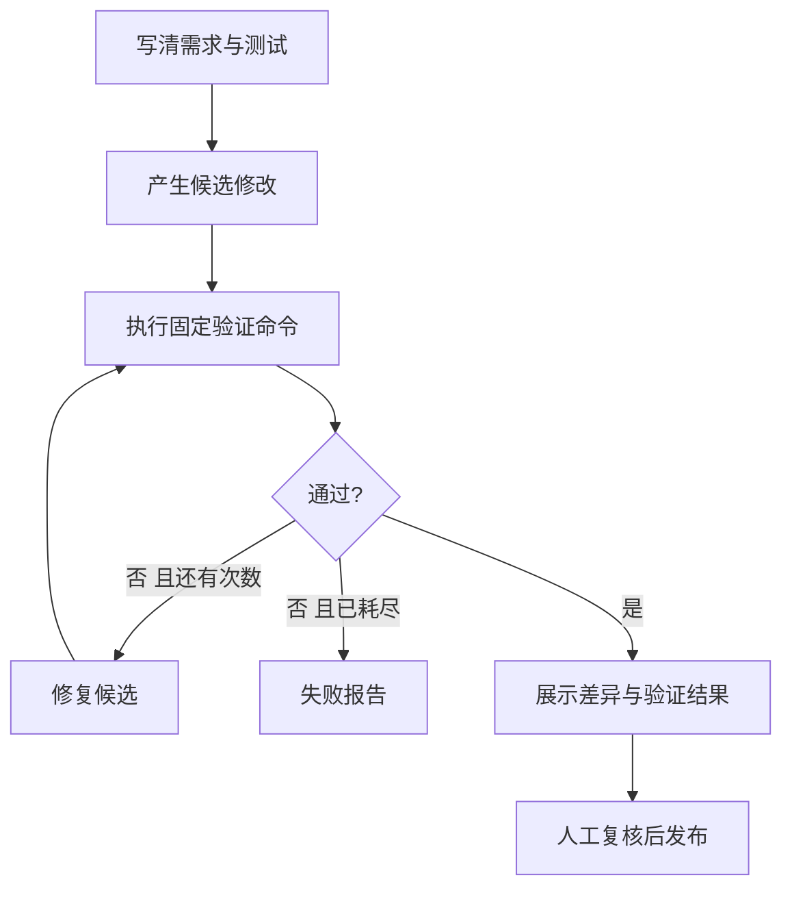

<a id="development"></a>

## 第七章：搭建自己的开发工作流

### 7.1 先把一个小修改做成可验收流程

个人开发流程可以从“需求→验收条件→实现→测试→修复→复核→待发布”开始。图负责状态和执行顺序；真实模型可以辅助提需求、写代码和解释测试失败；是否合格仍由可检查证据判断。



例如这次目标是“线性查找应当检查最后一个元素”。验收条件先写出来：空数组返回 -1；最后一个元素命中时返回对应下标；不存在返回 -1。这样无需依赖模型一句“已经修好”。

### 7.2 实战 12：测试发现问题，有限修复再验证

```text
labpy lab12_dev_workflow.py
```

{{CODE:labs/lab12_dev_workflow.py}}

第一次候选的 `range(len(nums)-1)` 跳过最后一个元素；`test_last` 失败。修复节点换成已经写在教程里的正确候选；第二次三项测试通过。预期：`status=READY_FOR_REVIEW`、`attempts=2`、`passed=true`，并生成 `outputs/dev_report.json`。

这是完整的本地“写候选→执行测试→修复→报告”工作流，但候选与修复均由教程预先编写，**没有声称让模型自主写代码**。不修改 NemoOJ 源码，不提交 Git，不执行部署。

### 7.3 为什么测试命令是固定的

脚本使用 `subprocess.run` 的参数列表，不用 `shell=True`，且只允许固定的 Python unittest 命令。执行有 20 秒超时；图最多两次尝试；候选只写到临时目录。

将来接真实模型生成代码时，普通 subprocess 不是隔离边界。需要在受控环境中运行，限制网络、目录、CPU、内存、进程和输出。NemoOJ 已有用户代码沙箱，可学习其隔离思路；不要直接给开发 Agent 生产 Docker socket或云端 root 权限。

“测试代码也是模型写的”时要特别注意：它可能照着错误实现写错误期望。核心验收用例应从需求独立推导。本例的最后元素、空数组和缺失目标属于可观察行为，因此能发现实现边界问题。

### 7.4 从练习迁移到真实 NemoOJ 开发

每次任务可以生成一份记录：

```json
{
  "goal": "修复某个可复现问题",
  "acceptance": ["明确触发步骤", "正确结果", "权限边界"],
  "allowed_paths": ["限定模块"],
  "checks": ["固定测试命令"],
  "max_attempts": 2,
  "status": "READY_FOR_REVIEW"
}
```

这只是记录格式示意，不是新增运行程序。推荐流程：在开发分支准备最小复现；完成修改后运行该模块所需检查；失败时归类为代码问题、环境问题或测试问题；把变更与证据一起复核；部署步骤独立处理。

前端的小样式修改无需为了“工作流完整”机械增加大量测试；用户归属、付费预算、判题协议这类变化，则需要针对失败和并发的验证。测试量与风险匹配。

### 7.5 CI/CD 与 Agent 工作流是什么关系

CI 是提交后自动执行构建/测试，CD 管理交付或部署步骤；Agent 可以在提交前帮助产生候选和解释失败。它们解决不同环节，可以结合，不能互相替代。

本仓库已有 [ci.yml](/C:/Users/nemo/Desktop/NemoOJ/.github/workflows/ci.yml)，将单元、真实中间件集成和 Docker 沙箱测试分层，并检查是否确实执行了测试。当前教学任务只读取此配置，没有触发云端 CI，也没有宣称最近某次运行已通过。GitHub 工作流结构参考 [Understanding GitHub Actions](https://docs.github.com/en/actions/get-started/understand-github-actions)。

### 7.6 给工作流加可观察性

至少记录任务编号、节点名称、起止时间、状态、重试次数、模型名和工具名。日志不应默认保存所有用户源码或 Key。需要调试原始响应时，先定义访问权限、保留期限与脱敏。

图检查点回答“流程走到哪里”；业务数据库回答“用户看到的最终事实”；日志/指标回答“为什么慢或失败”。三者可以关联，但不是同一种存储。

对个人开发任务，可以先保存本地 JSON 报告；对生产业务，需要将任务状态、结果和预算记录设计成可恢复数据。不能靠终端最后一行文字维持整个系统。

### 7.7 版本控制也包括提示词和评测

代码、Schema、提示词、图路由、知识资料、评测用例都需要版本记录。模型/提示词变更可能使旧检查点不能被新节点正确解释；长任务恢复前要检查兼容性，必要时保留旧图版本执行旧任务。

不要仅记录“切换了更强模型”。应记录旧/新模型标识、数据集版本、通过率、费用和时延。第九章提供最小评测入口；之后可以将它作为发布前检查之一。

本章验收：第一次测试能实际失败，第二次通过；重试不会无上限；报告可读；能说明程序执行候选代码的范围；知道真实开发流程的哪些步骤尚未自动化。
